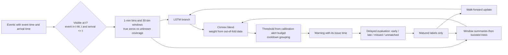

# TDAM research companion: point-in-time cyber threat forecasting

Companion code for **Partha Chakraborty**, *Cyber Threat Prediction Using Temporal Data Analysis Model*, 2026 6th International Conference on Intelligent Technologies (CONIT), Belgavi, India, 19-21 June 2026. DOI [10.1109/CONIT69683.2026.11620680](https://doi.org/10.1109/CONIT69683.2026.11620680) · [IEEE record](https://ieeexplore.ieee.org/document/11620680).
Author and repository maintainer: Partha Chakraborty (MIT licence).

**Research question:** given only telemetry a defender could see at time *t*, can a model warn before the next annotated incident begins? Every answer here is inspectable down to timestamped predictions, matched warnings and missed incidents.

> **Honest scope.** The full paper text could not be read (IEEE blocks automated access), and the abstract gives no dataset, layer sizes, window, horizon, update rule or numbers. This is therefore a **reference implementation with companion defaults**, not a reproduction of the paper's results. See [docs/paper-map.md](docs/paper-map.md).

## Install and quick start (CPU)

```bash
pip install torch --index-url https://download.pytorch.org/whl/cpu   # optional: small CPU wheel
pip install -e ".[dev]"
tdam demo            # generate synthetic data, validate, train, evaluate, write docs/results.md (several minutes)
```

Local file prediction (CSV or JSONL with `event_id,entity,event_time,arrival_time,outcome,dst`):

```bash
tdam train --data data/demo --out models/demo
tdam predict --bundle models/demo --events examples/sample/events.jsonl --out predictions.csv --stride 5
```

Full workload on a prepared dataset: `tdam run --data data/demo --out runs/full --report docs/results.md`. Independent benchmark: see [docs/data-card-lanl.md](docs/data-card-lanl.md). Replay a saved set in arrival order: `tdam replay --data data/demo --bundle models/demo --out replay.csv`.

## Which runs used which data

| Run | Data | Status |
|---|---|---|
| `results/demo` (`tdam demo`) | **Synthetic**, original seeded generator, seed 7 | Executed. Demonstration only. |
| LANL benchmark | **Independent**, LANL cyber1 (owner downloads) | Adapter implemented and format-tested. **Not run.** |
| Paper's original study | **Unidentified** | Not reproducible: dataset, split and numbers unavailable. |

## One real prediction trace

`results/demo/traces/` holds real rows from `predictions_test.csv.gz`: [early](results/demo/traces/trace_early_H005-I07.csv) (5 min lead), [late](results/demo/traces/trace_late_H003-I06.csv) (1 min after onset), [missed](results/demo/traces/trace_missed_H009-I03.csv). Plot: `results/demo/figures/traces.png`. Full tables: [docs/results.md](docs/results.md).

## Flow



## Results summary (synthetic fixture, test partition, one seed, 25 incidents)

Same alert budget (at most 0.03 unmatched warnings per monitored host-hour, chosen on calibration data). Source: `results/demo/metrics.json`, `incident_ledger.csv`, `alerts.csv`.

| model | advance warnings | late-only detections | missed | false alarms (unmatched) |
|---|---|---|---|---|
| prevalence-only | 0 | 0 | 25 | 0 |
| logistic | 3 | 22 | 0 | 18 |
| tree | 4 | 14 | 7 | 16 |
| LSTM | 4 | 21 | 0 | 23 |
| ensemble | 4 | 17 | 4 | 21 |

Most incidents are detected only after onset, no model clearly beats the others at this sample size, and "false alarm" means *unmatched to known labels*. See `docs/results.md` for adaptive, order-shuffled and latency results. Latency was measured on a shared, busy machine; treat the p95/p99 as upper-noisy.

## Differences from the paper

Everything architectural is a companion default (see [docs/architecture.md](docs/architecture.md)): 1-minute bins, W = 30, H = 5 min, one 64-unit LSTM, boosted trees, convex blend, walk-forward updates. Only the authentication modality is used.

## Layout

`src/tdam/{data,temporal,models,training,evaluation}`, `configs/`, `examples/sample/` (small JSONL), `docs/`, `references/reported/`, `results/demo/`, `tests/` (CI: ruff + pytest with coverage gate). Data and model bundles larger than samples stay out of Git (`data/` is ignored).
